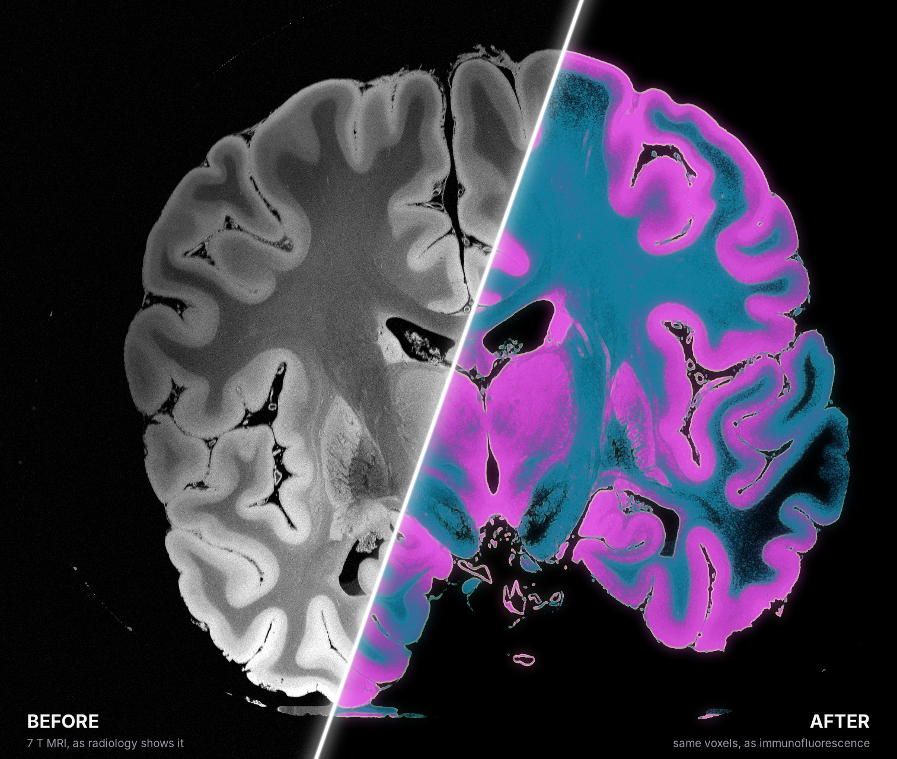
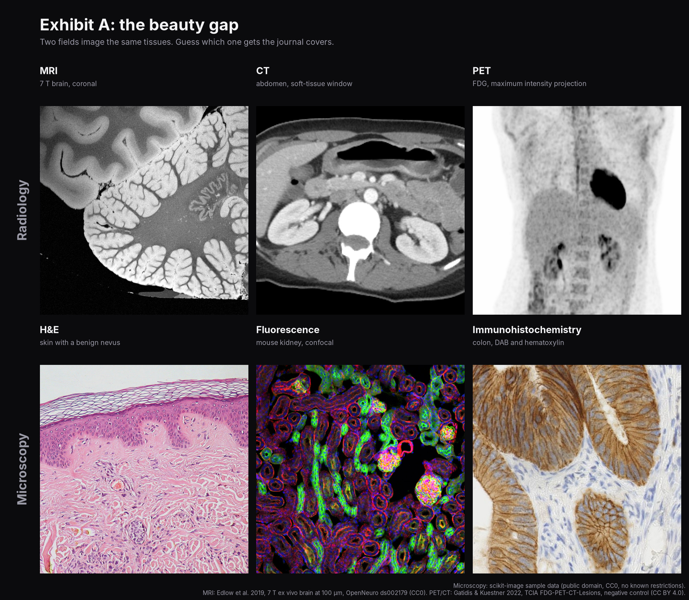
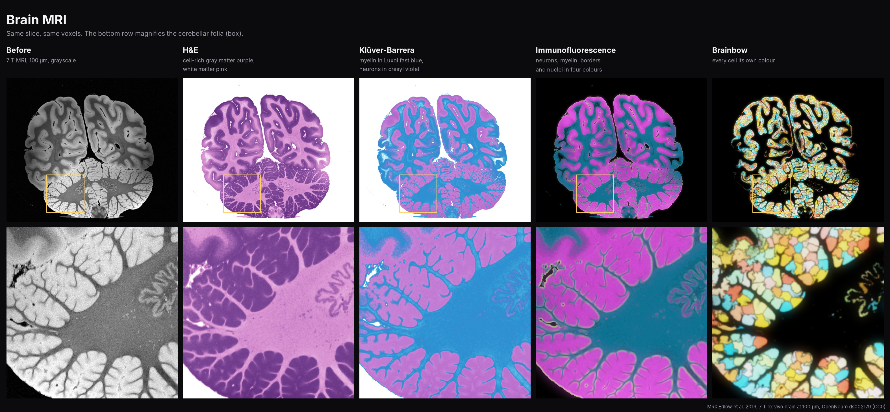
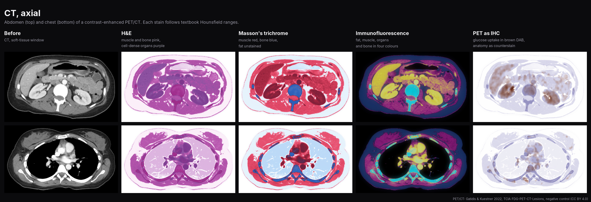
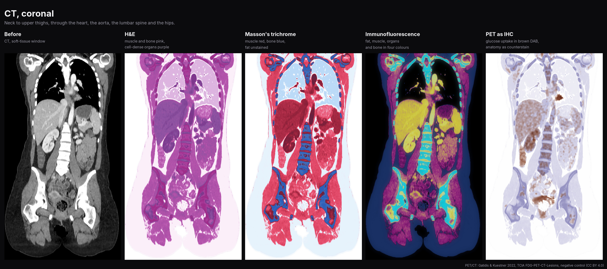
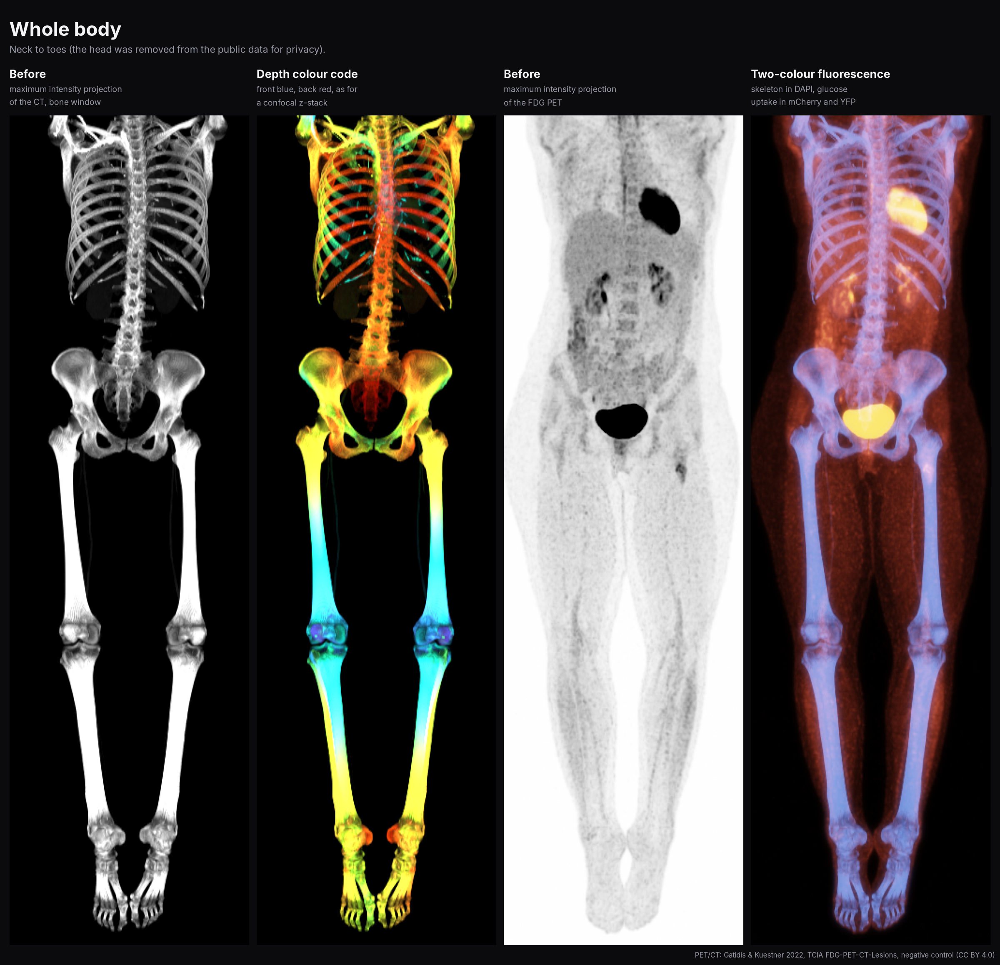

# make-medical-imaging-beautiful-again

**Radiology, restyled as microscopy.** Real MRI, CT and PET scans rendered as H&E, Klüver-Barrera, trichrome,
immunohistochemistry, immunofluorescence and Brainbow. Same voxels, new outfit.



## The problem



## The fix






Plus 27 LinkedIn banners (1584 × 396 px) in [`gallery/linkedin_banners/`](gallery/linkedin_banners/)
([overview](gallery/linkedin_banners/_overview.jpg)).

## How

Each scan becomes soft tissue maps (MRI: shading-corrected Otsu classes; CT: Hounsfield ranges; PET: SUV), which
are then stained: brightfield stains absorb light (Beer-Lambert), fluorophores add coloured light on black. Every
colour is a fixed function of the voxels; only the glow and the Brainbow colours are cosmetic. Recipes are in
[`glowup/recipes.py`](glowup/recipes.py). Not for diagnosis.

## Run

```bash
git clone https://github.com/pcabrales/make-medical-imaging-beautiful-again.git
cd make-medical-imaging-beautiful-again && pip install -e ".[dev]"
python scripts/make_gallery.py   # figures; the first run downloads about 600 MB of public data
python scripts/make_banners.py   # banners
pytest
```

Python ≥ 3.10.

## Data

- **Brain MRI:** Edlow et al., 7 Tesla MRI of the ex vivo human brain at 100 micron resolution, *Sci Data* 6, 244
  (2019), [doi:10.1038/s41597-019-0254-8](https://doi.org/10.1038/s41597-019-0254-8).
  [OpenNeuro ds002179](https://openneuro.org/datasets/ds002179), CC0.
- **PET/CT:** Gatidis & Kuestner, FDG-PET-CT-Lesions, The Cancer Imaging Archive (2022),
  [doi:10.7937/gkr0-xv29](https://doi.org/10.7937/gkr0-xv29), CC BY 4.0; described in Gatidis et al., *Sci Data* 9,
  601 (2022). One defaced negative-control study. TCIA: Clark et al., *J Digit Imaging* 26, 1045 (2013).
- **Microscopy references:** scikit-image sample data (public domain, CC0, no known copyright restrictions).

Code: [MIT](LICENSE). The images are derived from the data above, under its licences.
