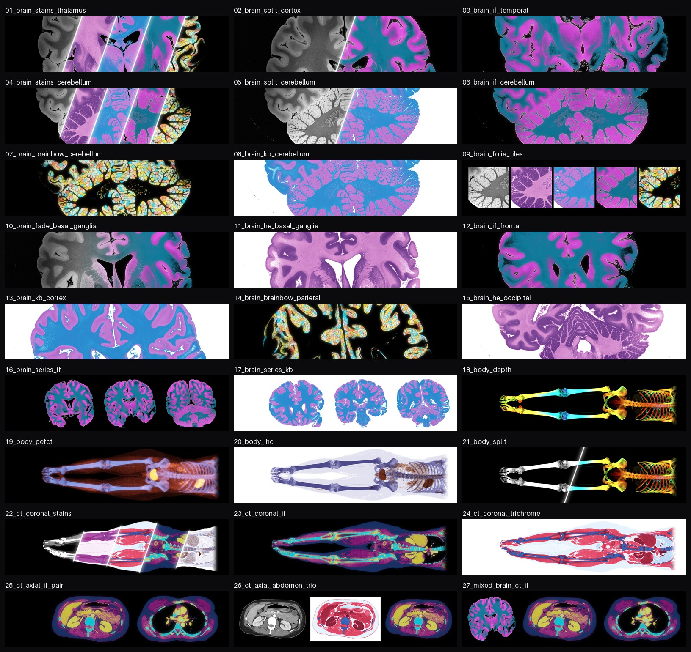

# Make medical imaging beautiful again


Microscopy and pathology win every beauty contest. Their images glow in magenta, cyan and gold, and they end up on journal covers. Radiology shows the same organs in shades of gray.

This repository closes the gap. It takes real, public MRI, CT and PET scans and renders them in the visual language of the microscopy lab: H&E, Klüver-Barrera, Masson's trichrome, immunohistochemistry, multiplexed immunofluorescence, Brainbow and confocal depth colour coding. Same voxels, new outfit.

## Exhibit A: the beauty gap


Top row: radiology as it is usually shown. Bottom row: microscopy as it is usually shown. The case rests.

## The makeover

### Brain MRI


A coronal slice of a 7 T scan of an ex vivo human brain at 100 µm (Edlow et al., 2019). Gray matter, rich in neurons, takes hematoxylin and cresyl violet; white matter, rich in myelin, takes eosin and Luxol fast blue, as in a neuropathology lab. The bottom row magnifies the folia of the cerebellum.

### CT, axial


Abdomen and chest from a whole-body FDG PET/CT. Each stain follows textbook Hounsfield ranges for fat, soft tissue, contrast-enhanced organs and bone. In the last column, glucose uptake from the PET becomes brown DAB on a hematoxylin counterstain, the way immunohistochemistry marks where an antibody bound.

### CT, coronal


### Whole body


The skeleton projected front to back and coloured by depth, like a confocal z-stack in Fiji. Then PET/CT as a two-colour fluorescence image: skeleton in DAPI blue, glucose uptake in mCherry red that burns to YFP gold where it is highest (the heart and the bladder).

### LinkedIn banners



`gallery/linkedin_banners/` holds 27 profile banners at LinkedIn's recommended 1584 × 396 px, about two thirds of them brain. The brain banners are crops at the scan's native 100 µm resolution. LinkedIn's profile photo covers part of the lower left on desktop, so the subjects sit in the centre or to the right. The CT body banners use a curved coronal plane that follows the skeleton, so the whole body, legs included, lies across the banner.

## How it works

Every image goes through two steps.

1. **Tissue maps.** Each scan becomes soft maps of tissue classes, with values from 0 to 1.
   - MRI: the slice is divided by a smooth estimate of the receive-coil shading (a normalized convolution over white matter), then Otsu thresholds split background, white matter and gray matter.
   - CT: Hounsfield ranges for aerated lung, fat, soft tissue, contrast-enhanced tissue and bone, with soft logistic edges.
   - PET: activity is converted to standardized uptake values (SUV) using the body weight and the decay-corrected dose in the DICOM header.
2. **Rendering.** The maps become stain amounts or fluorescent signals.
   - Brightfield stains (H&E, Klüver-Barrera, trichrome, immunohistochemistry) follow the Beer-Lambert law: each stain has an optical density per colour channel, and the light transmitted through the slide is 10^(−Σ amount × density). The hematoxylin and eosin densities were measured from a real H&E slide (scikit-image's `skin`) with Macenko's method; the DAB density is Ruifrok and Johnston's.
   - Fluorescence adds each fluorophore's colour on black and saturates softly (1 − e^(−light)), like a camera, with a faint glow of out-of-focus light.
   - The depth colour code tints each slice with the turbo colour map by its depth and keeps the maximum per channel, like Fiji's "Temporal-Color Code".
   - Brainbow cuts the cortex into superpixels (SLIC) and gives each one a random mix of CFP, YFP and mCherry, with dark seams between them like cell membranes.

Which map goes into which stain, and how much, is in [`glowup/recipes.py`](glowup/recipes.py).

## Is this cheating?

A little, and only on the surface. Every colour is a fixed function of the scan's own voxel values: the same tissue always gets the same colour, and no structure is drawn that is not in the scan. Two things are purely cosmetic: the glow around the fluorescence images (a blurred copy of the image) and the Brainbow colours, which are random per superpixel (the "cells" are superpixels, not neurons). The stains mark MRI signal and Hounsfield ranges, not molecules: the H&E panels do not know where cell nuclei are. None of this is for diagnosis.

## Reproduce

Python 3.10 or newer:

```bash
python -m venv .venv
source .venv/bin/activate
pip install -e ".[dev]"
python scripts/make_gallery.py   # every figure, or name some: hero problem brain ct coronal body
python scripts/make_banners.py   # every banner, or those whose names contain an argument: brain body ct
pytest
```

The first run downloads the data into `data/` (set `GLOWUP_DATA` to put it elsewhere). Each brain slice (about 2 MB) is read straight out of the published 2 GB zip with HTTP range requests: the gallery needs two slices and the banners four more. The PET/CT study comes from TCIA (about 600 MB unpacked, plus about 400 MB of caches). After that, the gallery takes about a minute on a laptop CPU and the banners a few minutes.

| Path | Contents |
| --- | --- |
| `glowup/data.py` | Downloads and loaders: brain slices, DICOM series, SUV conversion |
| `glowup/tissue.py` | Tissue maps from MRI and CT intensities |
| `glowup/styles.py` | Stains, fluorophores and the renderers |
| `glowup/recipes.py` | Which tissue map gets which stain |
| `glowup/figure.py` | Figure layout, crops and diagonal splits |
| `scripts/` | The gallery and banner builders |
| `tests/` | Unit tests on synthetic images |

## Data and credits

- **Brain MRI:** Edlow BL, Mareyam A, Horn A, et al. 7 Tesla MRI of the ex vivo human brain at 100 micron resolution. *Scientific Data* 6, 244 (2019). [doi:10.1038/s41597-019-0254-8](https://doi.org/10.1038/s41597-019-0254-8). Data: [OpenNeuro ds002179](https://openneuro.org/datasets/ds002179), CC0.
- **PET/CT:** Gatidis S, Kuestner T. A whole-body FDG-PET/CT dataset with manually annotated tumor lesions (FDG-PET-CT-Lesions) [Dataset]. The Cancer Imaging Archive (2022). [doi:10.7937/gkr0-xv29](https://doi.org/10.7937/gkr0-xv29). CC BY 4.0. Described in Gatidis S, Hepp T, Früh M, et al. A whole-body FDG-PET/CT dataset with manually annotated tumor lesions. *Scientific Data* 9, 601 (2022), [doi:10.1038/s41597-022-01718-3](https://doi.org/10.1038/s41597-022-01718-3). The gallery uses the public, defaced images of one negative-control study (no PET-positive lesions); the head was removed by the data providers. Use of TCIA data is subject to the TCIA data usage policy.
- **TCIA:** Clark K, Vendt B, Smith K, et al. The Cancer Imaging Archive (TCIA): maintaining and operating a public information repository. *Journal of Digital Imaging* 26, 1045–1057 (2013). [doi:10.1007/s10278-013-9622-7](https://doi.org/10.1007/s10278-013-9622-7).
- **Microscopy in Exhibit A** (scikit-image sample data): `skin`, H&E of skin with a benign nevus by Kilbad, public domain; `kidney`, confocal fluorescence of mouse kidney by Genevieve Buckley (Monash Micro Imaging), CC0; `immunohistochemistry`, colonic glands from the Center for Microscopy and Molecular Imaging, no known copyright restrictions.
- **Methods:** Macenko M, et al. A method for normalizing histology slides for quantitative analysis. *ISBI* 2009, 1107–1110. Ruifrok AC, Johnston DA. Quantification of histochemical staining by color deconvolution. *Analytical and Quantitative Cytology and Histology* 23, 291–299 (2001).
